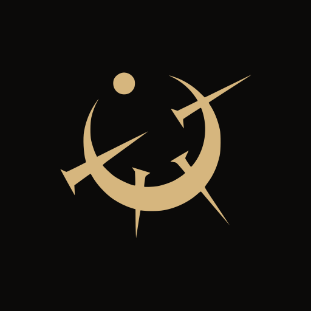
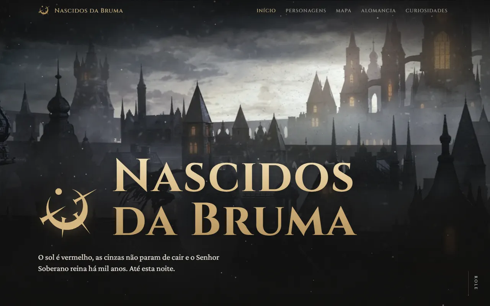
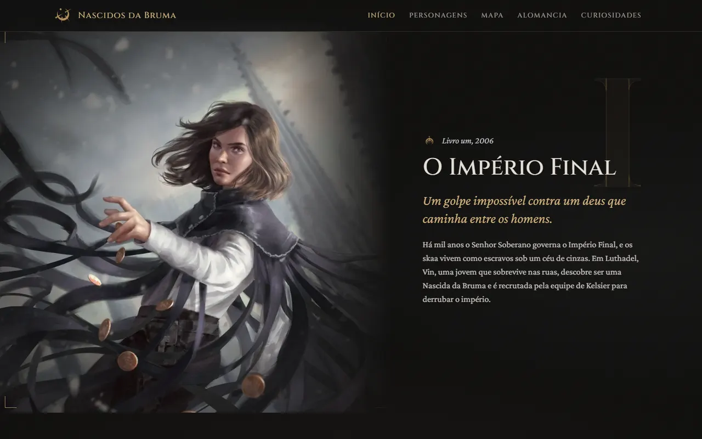
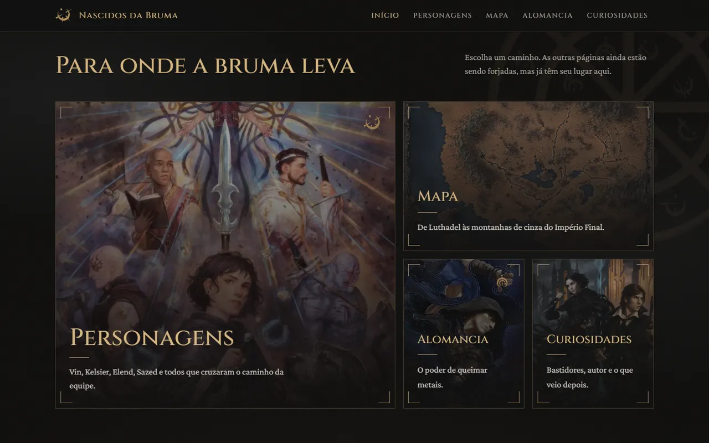
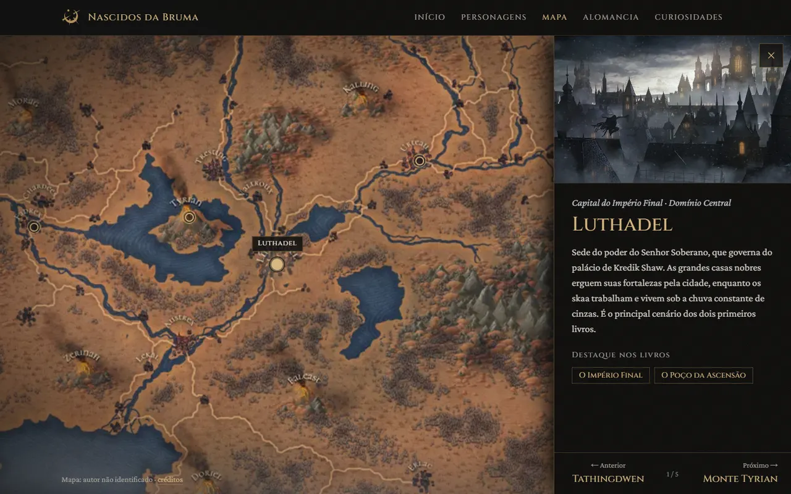
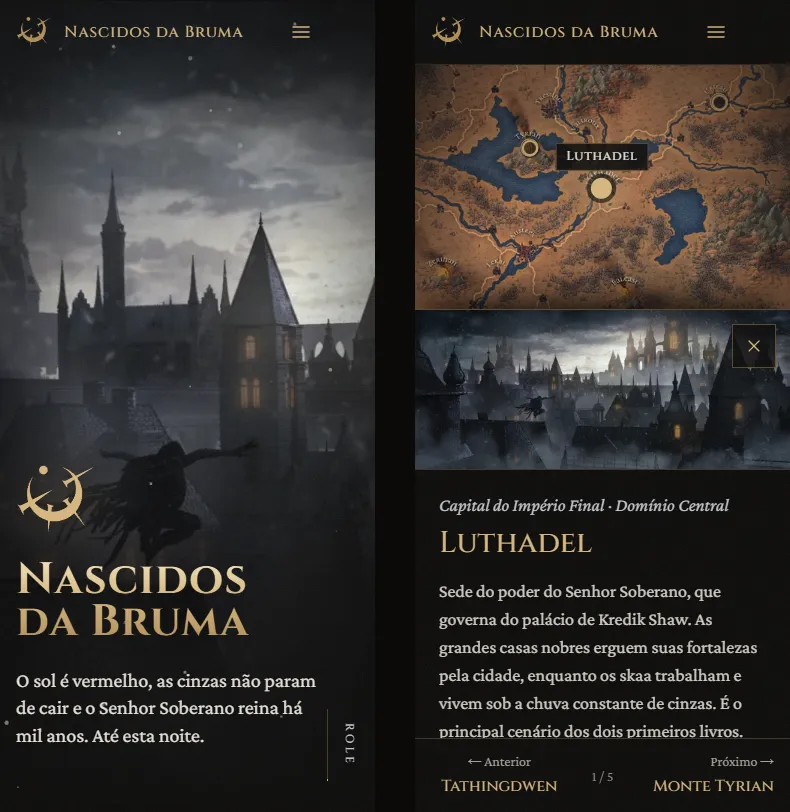

<div align="center">



# Nascidos da Bruma

**Um site de fã sobre _Mistborn_, a trilogia de Brandon Sanderson**

_O sol é vermelho, as cinzas não param de cair e o Senhor Soberano reina há mil anos. Até esta noite._


</div>



## Sobre o projeto

Trabalho de **front-end do 1º ano de faculdade**: um site de fã sobre o Império Final, feito só com **HTML, CSS e JavaScript puro**, organizado com Vite e estilizado com Tailwind CSS. Não usa React nem TypeScript.

A proposta visual vem do próprio livro: **cinzas, bruma e metal**. O fundo é carvão, os destaques imitam latão e estanho, há granulação, névoa animada por cima das artes e cinzas caindo num canvas. O layout é editorial e assimétrico, sem grade de cards iguais. Todo o conteúdo está em português do Brasil, com os termos da edição brasileira (Alomancia, Feruquemia, Senhor Soberano, skaa).

## O que tem no site

| Página | Status | Destaques |
| --- | :---: | --- |
| **Início** | ✅ | Hero em tela cheia com 3 camadas de bruma, parallax no mouse e cinzas em `<canvas>`. A trilogia aparece em blocos alternados com o número romano gigante ao fundo, e o menu visual tem tamanhos diferentes |
| **Mapa** | ✅ | Mapa interativo com 5 locais: zoom centralizado no ponto, painel lateral (ou bottom sheet no celular), navegação anterior/próximo e acesso pelo teclado |
| **Créditos das artes** | ✅ | Lista de artistas gerada a partir de um arquivo de dados |
| Personagens | 🚧 | Em construção |
| Alomancia | 🚧 | Em construção |
| Curiosidades | 🚧 | Em construção |

## Capturas de tela

<p align="center">
  
  
</p>



<p align="center">
  
</p>

## Tecnologias

- **[Vite 8](https://vite.dev/)**: servidor de desenvolvimento e build multi-página (`rollupOptions.input` no [vite.config.js](vite.config.js))
- **[Tailwind CSS v4](https://tailwindcss.com/)** com o plugin `@tailwindcss/vite`. As cores e fontes ficam no `@theme` de [main.css](src/styles/main.css) e viram classes como `text-latao` e `font-titulo`
- **JavaScript puro** em ES modules: header e footer são componentes que injetam HTML
- **[sharp](https://sharp.pixelplumbing.com/)** e **[potrace](https://github.com/tooolbox/node-potrace)** em scripts próprios para otimizar imagens e gerar os ícones
- **Google Fonts**: [Cinzel](https://fonts.google.com/specimen/Cinzel) nos títulos e [Crimson Pro](https://fonts.google.com/specimen/Crimson+Pro) no texto

## Como rodar

Precisa do **Node.js 20.19+ ou 22.12+**.

```bash
git clone https://github.com/alenarth/mistborn_fan_fedcp3.git
cd mistborn_fan_fedcp3
npm install
npm run dev
```

Depois é só abrir **http://localhost:5173**.

| Comando | O que faz |
| --- | --- |
| `npm run dev` | Servidor de desenvolvimento com recarga automática |
| `npm run build` | Gera a versão final na pasta `dist/` |
| `npm run preview` | Mostra a versão final no navegador para testar |
| `npm run imagens` | Converte as artes de `originais/imagens/` para WebP em `public/images/` (as originais ficam fora do Git) |
| `npm run icones` | Vetoriza o símbolo oficial e gera o favicon, os ícones PNG e o `site.webmanifest` |

## Estrutura

```
├── index.html, mapa.html, creditos.html      páginas prontas
├── personagens.html, alomancia.html,
│   curiosidades.html                         páginas em construção
├── vite.config.js                            build multi-página
├── public/
│   ├── images/                               artes em WebP (+ miniaturas/)
│   ├── favicon.svg, favicon-32.png,
│   │   apple-touch-icon.png, icon-512.png    ícones (gerados)
│   └── site.webmanifest
├── scripts/
│   ├── otimizar-imagens.js                   npm run imagens
│   └── gerar-icones.js                       npm run icones
├── docs/screenshots/                         imagens deste README
└── src/
    ├── main.js                               entrada de todas as páginas
    ├── styles/main.css                       tema, componentes e animações
    ├── components/                           header, footer e emblema
    ├── js/                                   cinzas, parallax, revelar, mapa, créditos
    └── data/                                 locais, créditos, personagens, metais...
```

## Adicionando um local no mapa

Os locais ficam em [src/data/locais.js](src/data/locais.js). Para descobrir a posição de um lugar novo:

1. Rode `npm run dev` e abra `/mapa.html`
2. Abra o console do navegador (F12)
3. **Segure Alt e clique** no lugar do mapa. O console mostra algo como `Posição no mapa → x: 77.6, y: 40.2`
4. Adicione um objeto novo no array com esses valores (os números abaixo são só um exemplo):

```js
{
  id: 'kredik-shaw',
  nome: 'Kredik Shaw',
  tipo: 'Palácio',
  regiao: 'Luthadel',
  x: 64.8,
  y: 52.1,
  descricao: 'Texto curto, sem spoilers.',
  livros: [1],   // opcional
  imagem: null,  // opcional: { src, alt, largura, altura }
},
```

O marcador, o painel e a navegação anterior/próximo se ajustam sozinhos.

<details>
<summary><strong>Técnicas usadas (resumo para a apresentação)</strong></summary>

### CSS

- **`@theme` do Tailwind v4:** o tema vira classes utilitárias
- **Granulação:** filtro SVG `feTurbulence` embutido como data URI num `body::after`
- **Bruma infinita:** camadas com o dobro da largura que andam até `-50%`, cada uma numa velocidade
- **Parallax:** o JS só grava `--mx`/`--my` e o CSS faz o movimento com `calc()`
- **`mask-image`:** pinta os símbolos alomânticos em latão e faz as artes se dissolverem no fundo
- **Cantoneiras de ferro forjado:** 8 `linear-gradient` de 1px num único pseudo-elemento
- **`grid-template-areas`:** monta o menu assimétrico, que muda em 3 tamanhos de tela
- **`clamp()`:** títulos que crescem com a tela, com limite mínimo e máximo
- **`aspect-ratio`, `left`/`top` em % e container queries (`cqw`/`cqh`):** mantêm os pontos do mapa no lugar em qualquer tela
- **Zoom do mapa:** `transform: translate() scale()` com `transform-origin: 0 0`, e `scale: calc(1 / var(--escala))` para os marcadores não crescerem junto

### JavaScript

- **`IntersectionObserver`:** animações de entrada ao rolar e pausa das cinzas fora da tela
- **`ResizeObserver`:** ajusta o canvas e recalcula o zoom do mapa quando a tela muda de tamanho
- **`requestAnimationFrame`:** anima as cinzas e limita o parallax a um cálculo por quadro
- **`matchMedia`:** verifica `prefers-reduced-motion` e `pointer: fine`
- **Renderização a partir de dados:** listas montadas com `map()` + `join()`

</details>

## Acessibilidade

- Contraste do texto acima de 4.5:1 sobre o fundo
- Link "Pular para o conteúdo", menu hambúrguer com `aria-expanded` e tecla Esc
- Marcadores do mapa são `<button>` com `aria-label`. O foco vai para o painel ao abrir e volta ao marcador ao fechar, e uma região `aria-live` anuncia a troca de local
- Com **`prefers-reduced-motion`** ativado, a névoa, as cinzas, o parallax, o zoom e as animações de entrada ficam parados
- Imagens com `alt` descritivo em português, `width`/`height` definidos e `loading="lazy"` (menos a do hero)
- Layout mobile first, testado em 375px e 1440px sem rolagem horizontal

## Deploy

O site é publicado na **[Vercel](https://vercel.com/)**: importe o repositório e o Vite é detectado sozinho (build `npm run build`, saída `dist`).

## Direitos autorais

Este é um **site de fã sem fins lucrativos**, feito como trabalho acadêmico. Ele não tem nenhuma ligação com Brandon Sanderson, Dragonsteel ou as editoras.

- **Mistborn** © Brandon Sanderson / Dragonsteel. Os símbolos alomânticos foram criados por Isaac Stewart (Dragonsteel).
- As artes são usadas apenas para fins educacionais, e todos os direitos pertencem aos seus autores. A lista completa de artistas está na página **Créditos das artes** ([creditos.html](creditos.html) / [src/data/creditos.js](src/data/creditos.js)).
- Os textos do site foram escritos para o projeto e não copiam trechos dos livros.

Se você é autor de alguma das artes e quer corrigir o crédito ou pedir a remoção, abra uma [issue](https://github.com/alenarth/mistborn_fan_fedcp3/issues).

<div align="center">
<br />
<sub>Feito com cinzas, bruma e um pouco de latão.</sub>
</div>
